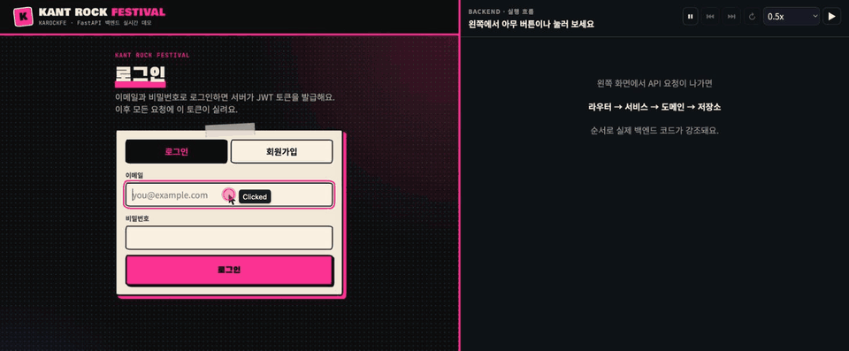
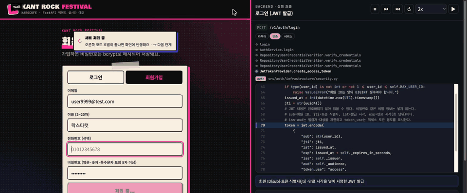

# 🎸 KAROCKFE — KANT ROCK FESTIVAL

## 🔥 READY TO ROCK?

**Five developers. One backend. One festival.**


> **공연은 무대에서, 예매는 코드로.**  
> 카락페는 콘서트 예매 시스템의 백엔드를 구현하는 D팀 프로젝트입니다.

관객이 공연을 발견하고 티켓을 예매하는 순간까지.  
회원·인증·공연·축제·티켓·예매·결제 도메인이 하나의 무대를 완성합니다.

---

## 🐈‍⬛ 시연

### 🐾 관리자 — 축제 생성 → 회차 생성



### 🐾 사용자 — 로그인 → 양일권 예매 → 결제 → 조회 → 취소 → 로그아웃



---

## 🤘 THE CREW

각자의 도메인을 연주하는 다섯 명의 백엔드 크루입니다.

|                         리더                          |                          부리더                           |                           서기                           |                           부서기                           |                         팀원                         |
| :---------------------------------------------------: | :-------------------------------------------------------: | :------------------------------------------------------: | :--------------------------------------------------------: | :--------------------------------------------------: |
|  |  |  |  |  |
|                        선병철                         |                          원정린                           |                          이명지                          |                           오명석                           |                        조성아                        |
|                      예매 도메인                      |                        티켓 도메인                        |                     공연·축제 도메인                     |                      인증·결제 도메인                      |                     회원 도메인                      |
|         [@tuski0](https://github.com/tuski0)          |       [@justinweon](https://github.com/justinweon)        |        [@mjlee0914](https://github.com/mjlee0914)        |       [@aiagentohms](https://github.com/aiagentohms)       |          [@jsa00](https://github.com/jsa00)          |

<br>

## ⚡ OUR GEAR

카락페의 무대를 움직이는 백엔드 장비입니다.

| 분류          | 기술                                       |
| ------------- | ------------------------------------------ |
| 언어          | Python 3.13                                |
| 프레임워크    | FastAPI, Uvicorn, Pydantic, Jinja2         |
| DB · ORM      | PostgreSQL, SQLAlchemy (asyncpg, greenlet) |
| 인증          | PyJWT, passlib[bcrypt]                     |
| 패키지 관리   | uv                                         |
| 인프라 · 협업 | Docker, GitHub                             |

<br>

## 🎫 SETLIST

- [공연 시작하기](#-공연-시작하기)
- [우리의 작업 흐름](#-우리의-작업-흐름)
- [Python · uv 규칙](#-python--uv-규칙)
- [ruff 사용법](#-ruff-사용법)
- [Docker 명령어](#-docker-명령어)
- [DB 연결 트러블슈팅](#-db-연결-트러블슈팅)

<br>

## 🚀 공연 시작하기

카락페 백엔드 무대를 로컬 환경에 세팅합니다.

### 1. 저장소 Clone 및 패키지 설치

```bash
git clone https://github.com/mjlee0914/BE-project-teamD.git
cd BE-project-teamD
uv sync
```

### 2. 환경 변수 파일 준비

`.env.example`을 복사해 로컬 환경 변수 파일을 만듭니다.

```bash
cp .env.example .env
```

### 3. PostgreSQL 컨테이너 실행

먼저 Docker Desktop이 실행 중인지 확인합니다.

```bash
docker compose up -d
docker compose ps
```

`STATUS`가 `Up`이라면 DB 준비 완료입니다.

### 4. FastAPI 서버 실행

프로젝트 루트에서 다음 명령어를 실행합니다.

```bash
uv run uvicorn main:app --app-dir src --reload
```

서버가 올라왔다면 카락페 공연 시작입니다. 🤘

<br>

## 🔄 우리의 작업 흐름

> **ISSUE → BRANCH → CODE → COMMIT → PR → REVIEW → MERGE**

각자 다른 파트를 연주해도 최종 무대는 하나입니다.  
작업 기록과 리뷰 흐름을 지키며 `dev` 브랜치에 코드를 합칩니다.

> ⚠️ `dev`에 바로 push하지 않습니다.  
> 반드시 작업 브랜치를 만들고 PR을 통해 합칩니다.

### 1. ISSUE — 오늘 연주할 파트 정하기

GitHub의 **Issues** 탭에서 양식에 맞춰 이슈를 생성하고 번호를 발급받습니다.

### 2. BRANCH — 나만의 스테이지 만들기

`dev` 브랜치를 최신 상태로 맞춘 후, 이슈 종류와 번호를 사용해 브랜치를 만듭니다.

```bash
git switch dev
git pull origin dev
uv sync
git switch -c feat/12-email-login
```

| 종류 | 브랜치 이름 예시      |
| ---- | --------------------- |
| 기능 | `feat/12-email-login` |
| 수정 | `fix/15-login-error`  |
| 기타 | `chore/18-uv-setup`   |

### 3. COMMIT & PUSH — 작업 기록 남기기

```bash
git add .
git commit -m "feat: 이메일 로그인 API 연동"
git push -u origin feat/12-email-login
```

> 💡 커밋 메시지는 작업 내용을 알아볼 수 있도록 작성합니다.  
> 의미 없는 `.` 대신, 어떤 코드를 연주했는지 기록해 주세요.

### 4. PULL REQUEST — 합주 요청하기

1. Push 후 GitHub 저장소의 **Compare & pull request**를 클릭합니다.
   - 버튼이 없다면 **Pull requests → New pull request**로 이동합니다.
   - `base: dev` ← `compare: 내 브랜치`인지 확인합니다.
   - `base`와 `compare`가 모두 `dev`라면 비교할 작업이 없어 PR을 만들 수 없습니다.
2. 자동으로 표시되는 PR 템플릿을 항목별로 작성합니다.
3. **Assignees**에는 본인을, **Reviewers**에는 팀원을 지정합니다.
4. **Create pull request**를 클릭해 리뷰를 요청합니다.

#### PR 템플릿 작성 가이드

| 항목                       | 작성 방법                                                                   |
| -------------------------- | --------------------------------------------------------------------------- |
| 🔗 관련 이슈               | `close #12` 형식으로 작성합니다. `dev`에 머지되면 이슈가 자동으로 닫힙니다. |
| 📝 작업 내용               | 어떤 기능을 구현하거나 수정했는지 작성합니다.                               |
| 💡 고민한 점 / 리뷰 포인트 | 구현 이유와 리뷰어가 집중해서 확인할 부분을 작성합니다.                     |
| 🧪 확인 방법               | 리뷰어가 같은 결과를 재현할 수 있도록 작성합니다.                           |
| 📷 스크린샷                | 필요한 경우 Swagger 응답이나 터미널 로그를 첨부합니다.                      |
| ✔️ 체크리스트              | 제출 전 `[ ]`를 `[x]`로 바꾸며 확인합니다.                                  |

#### 무대에 오르기 전 체크리스트

- [ ] Assignees에 본인을 지정했나요?
- [ ] Reviewers에 팀원을 지정했나요?
- [ ] 서버를 실행해 변경 사항을 확인했나요?
- [ ] 패키지 추가 시 `pyproject.toml`과 `uv.lock`을 함께 커밋했나요?
- [ ] `.venv`, `__pycache__`, `.env`가 커밋에서 제외됐나요?
- [ ] 디버깅용 `print()`와 불필요한 주석을 제거했나요?

서버 실행 명령어:

```bash
uv run uvicorn main:app --app-dir src --reload
```

### 5. REVIEW & MERGE — 합주 마무리하기

1. 리뷰 코멘트가 등록되면 같은 브랜치에서 수정하고 다시 Push합니다.
2. 변경 내용은 기존 PR에 자동으로 반영됩니다.
3. 승인을 받으면 **Merge pull request**로 `dev`에 합칩니다.
4. 연결한 이슈가 자동으로 닫혔는지 확인합니다.
5. 연주가 끝난 로컬 브랜치를 정리합니다.

```bash
git switch dev
git pull origin dev
git branch -d feat/12-email-login
```

<br>

## 🐍 Python · uv 규칙

같은 무대에서 다른 소리가 나지 않도록 Python 환경과 패키지는 `uv`로 통일합니다.

| 상황                       | 할 일                                                                            |
| -------------------------- | -------------------------------------------------------------------------------- |
| 처음 Clone하거나 Pull한 후 | `uv sync`로 패키지를 설치합니다.                                                 |
| 패키지를 새로 추가할 때    | `uv add 패키지명`을 사용하고 `pyproject.toml`, `uv.lock`을 함께 커밋합니다.      |
| 서버를 실행할 때           | 프로젝트 루트에서 `uv run uvicorn main:app --app-dir src --reload`를 실행합니다. |
| 커밋하면 안 되는 파일      | `.venv/`, `__pycache__/`, `.env`                                                 |
| 새 폴더를 만들 때          | 빈 `__init__.py`를 함께 만들어 `ModuleNotFoundError`를 방지합니다.               |

> ⚠️ `pip install`은 사용하지 않습니다.  
> `uv.lock`에 기록되지 않은 패키지는 다른 팀원의 환경에 설치되지 않습니다.

<br>

## 🧹 ruff 사용법

`ruff`는 공연 전 악기를 튜닝하듯 코드를 검사하고 정리하는 도구입니다.

커밋 전에는 반드시 **내가 작업한 파일이나 폴더만** 지정해 실행합니다.

### 명령어별 역할

| 명령어               | 역할                                                            | 파일 수정 여부 |
| -------------------- | --------------------------------------------------------------- | -------------- |
| `ruff check`         | 사용하지 않는 import, 변수, 정의되지 않은 이름 등을 검사합니다. | ❌             |
| `ruff check --fix`   | 자동으로 수정할 수 있는 문제를 정리합니다.                      | ✅             |
| `ruff format`        | 들여쓰기, 띄어쓰기, 따옴표와 줄바꿈을 통일합니다.               | ✅             |
| `ruff format --diff` | Format 적용 전에 변경될 내용을 보여줍니다.                      | ❌             |

### 파일 단위로 튜닝하기

```bash
uv run ruff check src/users/presentation/router.py
uv run ruff check --fix src/users/presentation/router.py
uv run ruff format src/users/presentation/router.py
```

### 폴더 단위로 튜닝하기

```bash
uv run ruff check src/users/
uv run ruff check --fix src/users/
uv run ruff format src/users/
```

여러 경로도 한 번에 지정할 수 있습니다.

```bash
uv run ruff check src/users/ src/shared/core/database.py
```

> 💡 추천 순서: `check --fix` → `format` → 변경 결과 확인 → Commit
>
> ⚠️ `--fix`와 `format`은 파일을 직접 수정합니다.  
> 다른 팀원의 파트까지 바뀌지 않도록 작업 범위를 정확히 지정해 주세요.

<br>

## 🐳 Docker 명령어

PostgreSQL은 `docker-compose.yaml`을 통해 모든 팀원의 PC에서 같은 구성으로 실행합니다.  
접속 정보는 `.env.example`에서 확인할 수 있습니다.

| 상황            | 명령어                                            | 설명                                                |
| --------------- | ------------------------------------------------- | --------------------------------------------------- |
| DB 무대 열기    | `docker compose up -d`                            | 컨테이너가 없으면 생성하고, 있으면 다시 실행합니다. |
| 상태 확인       | `docker compose ps`                               | `STATUS`가 `Up`이면 정상입니다.                     |
| 로그 확인       | `docker compose logs -f db`                       | DB가 실행되지 않을 때 원인을 확인합니다.            |
| 잠시 멈추기     | `docker compose stop`                             | 컨테이너만 정지합니다.                              |
| 다시 시작하기   | `docker compose start`                            | 정지한 컨테이너를 다시 실행합니다.                  |
| 컨테이너 내리기 | `docker compose down`                             | 컨테이너는 삭제하지만 데이터는 유지합니다.          |
| DB 초기화       | `docker compose down -v`                          | 컨테이너와 데이터를 모두 삭제합니다.                |
| DB 직접 접속    | `docker compose exec db psql -U admin -d karakpe` | PostgreSQL 콘솔에 접속합니다.                       |

> 💡 데이터는 `pgdata` 볼륨에 저장됩니다.  
> 컨테이너를 중지하거나 `down`해도 데이터는 유지됩니다.
>
> ⚠️ `docker compose down -v`는 DB 데이터를 모두 삭제합니다.  
> DB를 처음부터 다시 만들어야 할 때만 사용해 주세요.
>
> 💡 테이블은 Docker가 아니라 SQLAlchemy 기반 서버 코드가 생성합니다.  
> 컨테이너를 처음 실행하면 빈 `karakpe` 데이터베이스만 존재합니다.

<br>

## 🩺 DB 연결 트러블슈팅

공연 준비 중 앰프가 연결되지 않듯, 서버와 PostgreSQL의 연결이 끊어질 수 있습니다.  
아래 순서로 하나씩 점검합니다.

### `Connection to localhost:5432 refused`

```text
Connection to localhost:5432 refused. Check that the hostname and port are correct
and that the postmaster is accepting TCP/IP connections.
```

#### 1. 컨테이너 상태와 포트 확인

```bash
docker compose ps
```

| 보이는 상태                                              | 원인                                          | 해결                                          |
| -------------------------------------------------------- | --------------------------------------------- | --------------------------------------------- |
| 목록이 비어 있음 / `Cannot connect to the Docker daemon` | 컨테이너 또는 Docker Desktop이 꺼져 있습니다. | Docker Desktop 실행 후 `docker compose up -d` |
| `STATUS Up`, `PORTS 5432/tcp`                            | PC와 컨테이너 사이의 포트 연결이 빠졌습니다.  | 아래의 컨테이너 재생성 명령 실행              |
| `STATUS Up`, `PORTS 0.0.0.0:5432->5432/tcp`              | 정상 상태입니다.                              | `.env`의 `DATABASE_URL` 확인                  |

#### 2. 컨테이너 다시 만들기

```bash
docker compose down
docker compose up -d
docker compose ps
```

`PORTS`에 `0.0.0.0:5432->5432/tcp`가 표시되면 연결 준비가 완료된 것입니다.

> ⚠️ 이 과정에서는 `down -v`를 사용하지 않습니다.  
> `-v`를 붙이면 DB 데이터까지 삭제됩니다.

### `port is already allocated`

다른 PostgreSQL 컨테이너나 로컬 PostgreSQL이 이미 `5432` 포트를 사용하고 있다는 의미입니다.

```bash
docker ps
docker stop <컨테이너 이름>
docker compose up -d
```

다른 PostgreSQL도 함께 실행해야 한다면 로컬 설정의 포트를 변경합니다.

```yaml
ports:
  - "5433:5432"
```

`.env`의 `DATABASE_URL`도 `localhost:5433`으로 변경합니다.

> ⚠️ 개인 PC의 포트 변경 사항은 저장소에 커밋하지 않습니다.

---

### KANT ROCK FESTIVAL — KAROCKFE

**Five developers. One backend. One festival.**

